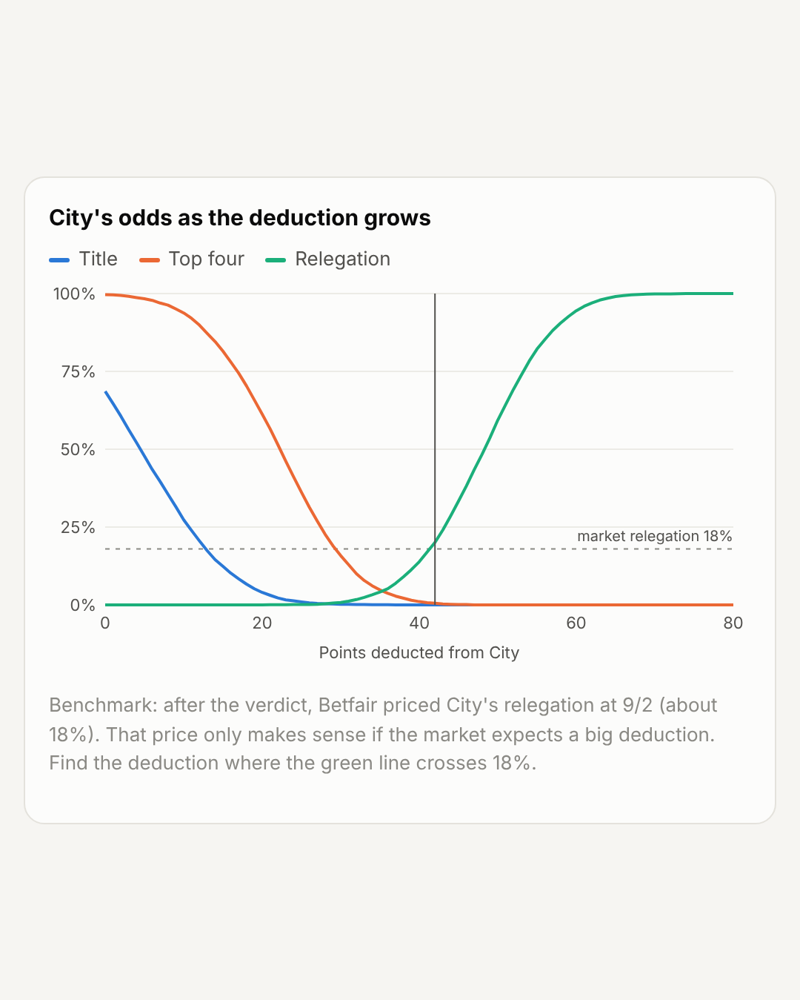

# The Asterisk Tables

**Rewriting Manchester City's decade, and pricing their punishment.**

In September 2026 Manchester City were reported to have been found guilty on 114 of the 115 Premier League financial charges, which cover 2009–10 to 2017–18. No sanction has been announced, and City are expected to appeal. This project puts numbers on the two "what ifs" everyone is arguing about.

**Interactive page:** [colinspel.github.io/city-asterisk-tables](https://colinspel.github.io/city-asterisk-tables/) — works on phone and desktop. Source: [`index.html`](index.html).

## 1. 2009–18 rewritten

The final tables for the nine seasons covered by the charges, under three scenarios:

- **Actual:** the real final tables.
- **Points deduction:** a slider (0–60 pts) applied to City every season, then the table is re-sorted.
- **Expunged:** City are removed and every team below them moves up a place.

Key findings:

| Season | City title lost at | New champion |
|---|---|---|
| 2011–12 | −1 pt | Man United |
| 2013–14 | −3 pts | Liverpool |
| 2017–18 | −20 pts | Man United |

## 2. 2026–27 deduction simulator

This section runs a Monte Carlo of the current season: 10,000 simulated finishes from the table after matchweek 7 (updated 20 Oct 2026), with City top on 21 points, 3 clear of Arsenal.

| Deduction | Title | Top four | Relegation |
|---|---|---|---|
| 0 | 69% | 100% | 0% |
| −10 | 27% | 94% | 0% |
| −20 | 4% | 61% | 0% |
| −30 | 0% | 16% | 1% |
| −40 | 0% | 1% | 14% |
| −50 | 0% | 0% | 59% |

After the verdict, Betfair priced City's relegation at 9/2 (about 18%). In this model, that price only holds with a deduction of roughly **42 points**.

City won again in matchweek 7 and their title chance still fell from 77% to 69%. Arsenal's rating rose on the latest prices, and with a round gone there's less season left for City's edge to compound.

## Method

- **Team ratings** (`model/fit_ratings.py`): one strength rating per team. Each rating blends current points per game, shrunk toward the league average, with bookmaker win/draw/loss odds for the last two rounds (matchweeks 7 and 8). Pooling two rounds stops one tough away fixture from swinging a team's rating. The fit is a penalized KL-divergence objective solved with SciPy.
- **Match model:** Davidson (Bradley‑Terry with draws), including a home-advantage term.
- **Simulation:** runs in the browser in JavaScript. Matchweek 8 uses the real fixtures. The remaining 30 games are played against random opponents, home or away at 50/50, and each team is simulated independently.
- **Historical ties:** teams level on points keep their original finishing order. This is an approximation of goal difference.

These are hypothetical scenarios, not predictions of the independent commission's ruling.

## Data sources

- Historical tables: official Premier League final standings, 2009–10 to 2017–18
- 2026–27 table: Football Web Pages, after matchweek 7 (19 Oct 2026)
- Odds: matchweek 7 from Sportradar (14 Oct 2026); matchweek 8 from the bets.co.za round-8 preview (20 Oct 2026), overround removed
- Verdict and betting context: The Athletic / The Times via Reuters, Sports Mole, Northeast Times

## Stack

Python (NumPy, SciPy) · vanilla JavaScript · SVG

---
Built by [Colin Spelman](https://www.linkedin.com/in/cspelman)
