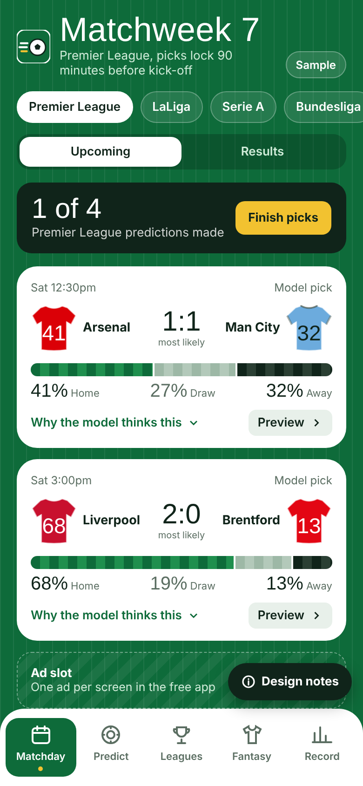
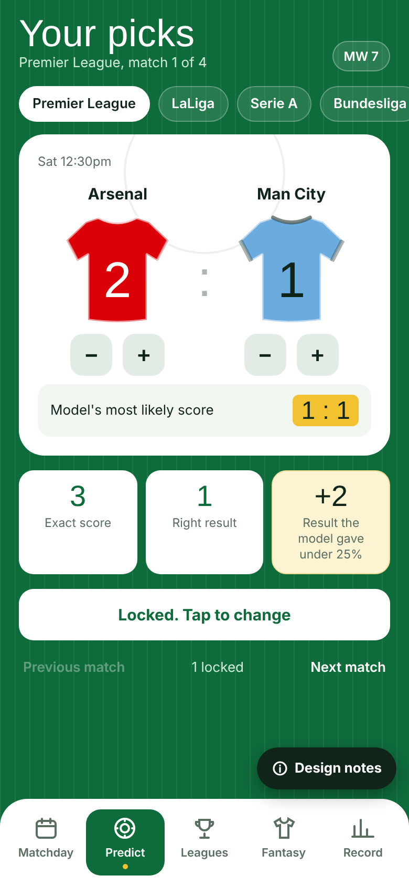
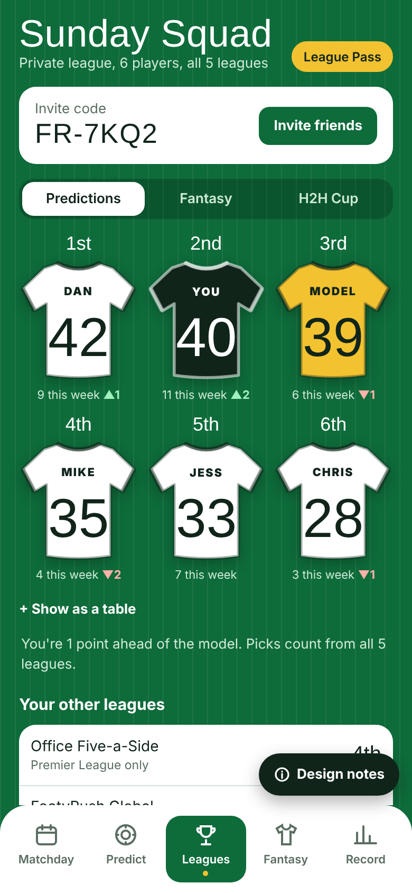
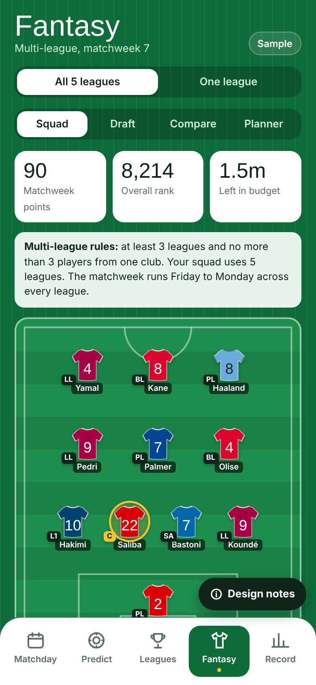
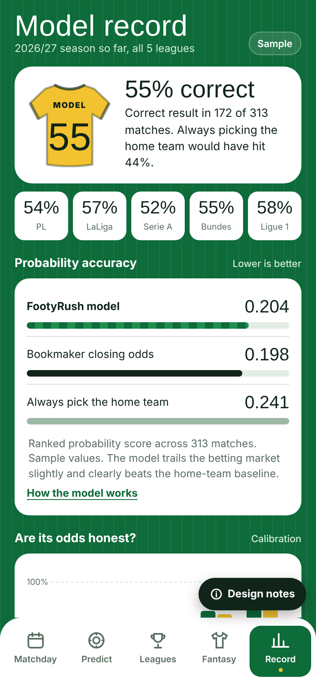

# FootyRush

**A soccer app for Europe's top five leagues.**

📱 **Open the app:** [colinspel.github.io/footyrush](https://colinspel.github.io/footyrush/) — works on phone and desktop.

FootyRush covers the Premier League, La Liga, Serie A, Bundesliga and Ligue 1 in one app:

- Live scores and league standings
- Match predictions from a Dixon-Coles / Poisson model, with the reasoning behind each pick
- Previews and tappable match pages with stats and ratings
- Player comparisons, including goalkeeper-specific metrics
- Multi-league fantasy with a draft mode, plus a single-league filter

🇺🇸 **MLS edition:** [colinspel.github.io/footyrush-mls](https://colinspel.github.io/footyrush-mls/) — the same app scoped to MLS, with a red MLS color scheme, fantasy and lineups.

The "Kit Room" design shows teams as shirts, with the numbers on the back carrying the data.

## Screenshots

| Matchday | Predict | Leagues |
|---|---|---|
|  |  |  |

| Fantasy | Record |
|---|---|
|  |  |

**Built with:** React, football-data.org API

*Source code is private while the app is in development.*

[← Back to all projects](../README.md)
