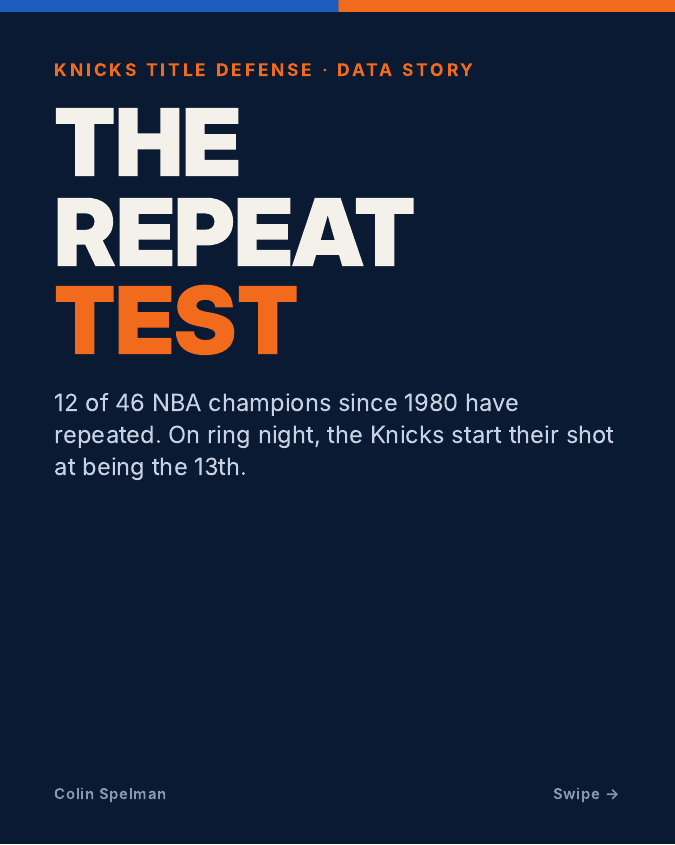
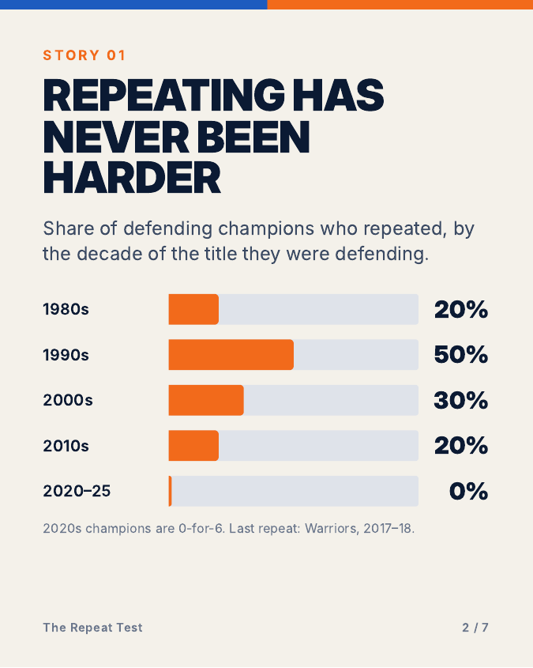
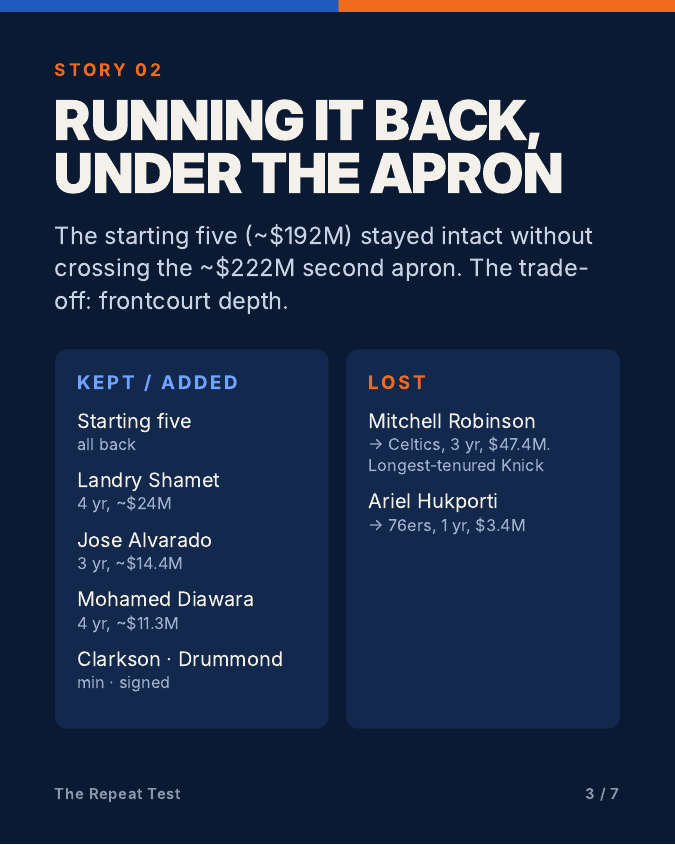

# The Repeat Test: Knicks Title Defense 2026-27

**12 of 46 NBA champions since 1980 have repeated. Can the Knicks be the 13th?**

A season-long data story on the Knicks' title defense, built from the business side as much as the basketball side: how the front office kept a champion together under the second apron, what the title did to ticket demand, and a weekly tracker measuring this team against the one that won.

📄 **Launch carousel:** [The_Repeat_Test.pdf](The_Repeat_Test.pdf) (7 slides, posted on LinkedIn Oct 19, 2026)

## The story so far

**Repeating has never been harder.** Share of defending champions who repeated, by the decade of the title they were defending:

| Decade | Repeated |
|---|---|
| 1980s | 2 of 10 (20%) |
| 1990s | 5 of 10 (50%) |
| 2000s | 3 of 10 (30%) |
| 2010s | 2 of 10 (20%) |
| 2020–25 | 0 of 6 (0%) |

The last repeat was Golden State in 2017–18.

**Running it back under the apron.** The starting five (about $192M) is intact without crossing the roughly $222M second apron. Landry Shamet, Jose Alvarado and Mohamed Diawara were re-signed and Jordan Clarkson and Andre Drummond added. The cost was frontcourt depth: Mitchell Robinson, the longest-tenured Knick, left for Boston on a 3-year, $47.4M deal, and Ariel Hukporti went to Philadelphia.

**16–3: the title run.** 4–2 over the Hawks, sweeps of the 76ers and Cavaliers, 4–1 over the Spurs. Eleven straight playoff wins, and Jalen Brunson's 45 points in Game 5 sealed Finals MVP. Every Finals game was within five points in the last five minutes, a first in the play-by-play era.

**The champion's premium.** Opening-week tickets averaged $1,212 at the Garden against a $326 NBA average, about 3.7× the league and second only to the 76ers (SeatPick via FOX 5 NY).

## The Repeat Tracker

Updated every Monday from Oct 26. Five metrics, each measured against the 2025-26 title team:

| # | Metric | Title-team baseline |
|---|---|---|
| 1 | Win pace | 53–29 |
| 2 | Point differential | +6.3 |
| 3 | Clutch record | 4–1 in the Finals |
| 4 | Frontcourt rebounding | Robinson's minutes now gone |
| 5 | Starting-five workload | The $192M core |

A sixth metric comes from the comments on the launch post.

### Weekly log

| Week | Date | Update |
|---|---|---|
| 0 | Oct 19 | Launch: The Repeat Test carousel |

**Data:** StatMuse, NBA.com, ESPN, Eurohoops, SeatPick via FOX 5 NY

*Independent project; not affiliated with the NBA or the New York Knicks.*

[← Back to all projects](../README.md)
