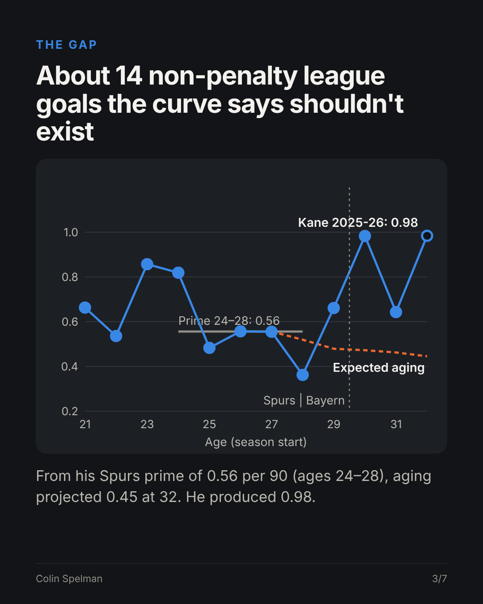

# Off the Curve: Harry Kane vs striker aging curves

**Harry Kane won the 2026 Ballon d'Or in a season he started at age 32. How far off the aging curve is that, and why?**

📄 **[Open the project page](https://htmlpreview.github.io/?https://github.com/colinspel/colinspel/blob/main/off-the-curve/index.html)** (works on a phone) · **[LinkedIn carousel (PDF)](linkedin/Kane_Off_the_Curve_carousel.pdf)**



## Key findings

| Finding | Number |
|---|---|
| Kane, 2025-26 Bundesliga non-penalty goals per 90 | **0.98** |
| Projected from his Spurs prime (0.56, ages 24–28) by the aging curve | **0.45** |
| Non-penalty league goals above expected aging | **~14** |
| Rank among 155 forward seasons started at age 32 since 2009-10 | **1st** (Lewandowski 0.92, Ronaldo 0.91) |

1. **My hypothesis failed.** I expected low-dribble "finishers" to age better than carriers. They decline earlier: −0.077 npG/90 by 29 relative to 27, while carriers are flat. Past 30 the samples thin and the gap is inside the noise.
2. **Kane isn't a clean finisher.** He sits at the 47th percentile of 729 profiled forwards on a carrying composite, so a two-bucket split can't describe him.
3. **The move explains most of it.** npxG per 90 rose from 0.47 at Spurs to 0.85 in his first Bayern season, with average shot distance down from ~17 to 14.4 yards. He still beat his npxG in 7 of 8 seasons.

**Recruitment takeaway:** price a 30+ striker on the chance environment he's joining, not on age alone.

## Method

- **Data:** FBref Big 5 league player-season tables, 2009-10 to 2024-25, from the [worldfootballR_data](https://github.com/JaseZiv/worldfootballR_data) release files. 6,114 forward seasons, 1,755 players (FW in most seasons, 900+ league minutes, seasons summed across clubs).
- **Metric:** non-penalty goals per 90. Age = age at season start (FBref convention).
- **Curves:** delta method. Year-over-year change between consecutive qualifying seasons, weighted by the harmonic mean of minutes, averaged by age (min. 15 pairs) and chained, anchored at 27. 80% intervals from 400 player-level bootstrap resamples.
- **Profiles:** z-scored mean of take-ons, progressive carries and carries into the box per 90, from 2017-18 on, using only seasons at age ≤29 so aging doesn't leak into the label. Median split into Carrier / Finisher.
- **Kane 2025-26:** 36 goals, 10 penalties, 2,377 minutes from bundesliga.com and StatMuse, because the FBref extract ends at 2024-25.

## Limits

- **Survivorship:** players who drop below 900 minutes or leave the Big 5 disappear, so late-career decline is understated. [Peak Window](../age-curves-by-position) corrects for this; this project doesn't yet.
- **Small late samples:** 47 carriers and 49 finishers have qualifying seasons at 31+.
- **No team-strength control:** Finding 3 says it matters. Next version: model npG/90 with team npxG share as a covariate.
- **League only:** Kane's 61 all-competition goals and World Cup goals aren't in the curve.

## Reproduce

```bash
python3 fetch_data.py   # downloads FBref tables, converts .rds with a pure-Python reader (rds.py), no R needed
python3 analysis.py     # aging curves, bootstrap, Kane comparison -> results.json
python3 build.py        # project page -> index.html
python3 carousel.py     # LinkedIn carousel -> linkedin/ (needs playwright)
```

**Tools:** Python (pandas, numpy), hand-built SVG charts, Playwright

[← Back to all projects](../README.md)
