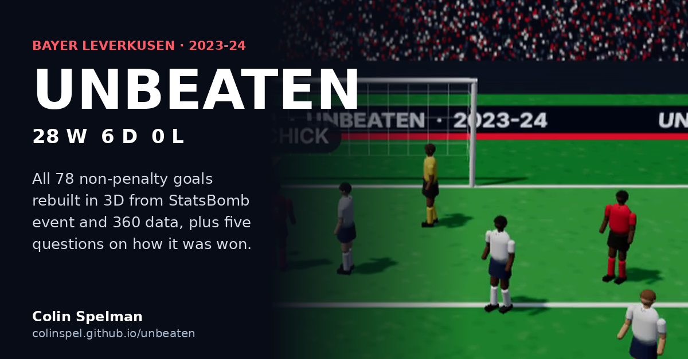

# Unbeaten: Leverkusen 2023-24, rebuilt from data

Bayer Leverkusen went the 2023-24 Bundesliga season without a loss: 28 wins, 6 draws, 90 points, 89 scored, 24 conceded. This project rebuilds all 78 of their non-penalty goals as 3D animations from Hudl StatsBomb event and 360 data, then asks five questions about how the season was won.

**[Open the interactive page](https://colinspel.github.io/unbeaten/)** (works on a phone; every goal is playable, in 3D or top-down)



## Findings

| Question | Answer | Baseline |
|---|---|---|
| How were goals built? | Median goal after 6 passes; 29% after 10+; 46% started in their own half | Opponents in the same matches: 2.5 passes (n = 24, small) |
| Who made it tick? | Xhaka involved in 29% of 20,174 completed open-play passes | Next highest: Tah, 18% |
| Who broke lines? | Xhaka played 15.8 line-breaking passes per 90; Frimpong, Wirtz and Hofmann received the most | Rate per pass equal to opponents (17.8% vs 18.4%); volume 84 vs 47 per match |
| Were the late goals luck? | Without their goals from the 85th minute on: 10 fewer points and 4 defeats | 13 goals from 8.8 xG after 85'; minutes 75-85 were their highest xG rate |
| Where did they win it back? | 28% of regains in the attacking third, 17 per match | Opponents 16%; shot-within-15s rate the same (35% vs 34%) |

The thread through all five: their edge was volume, not efficiency. Line-breaking rate and high-regain conversion were ordinary; how often they did both was not.

## How the animations work

**What is exact.** Every on-ball event (pass, receipt, carry, tackle, shot) places the player involved at the recorded location and time. The receiver of a completed pass is placed where the pass ends, so 96% of passes arrive within 1.5 yards of a player. Ground passes slow as they roll; low and high passes arc by StatsBomb's recorded pass height; shots finish at the recorded height in the goal.

**What is reconstructed.** Off-ball players come from 360 freeze frames, which capture everyone the broadcast camera could see at each event. Players are linked between frames by minimum-distance assignment (Hungarian algorithm) with a speed gate, working backwards from the shot freeze frame, where everyone is named. Paths between observations are cubic Hermite splines with capped tangents, so runs keep momentum without looping. Sightings that would need a sprint above 10 yd/s are dropped. A player off camera for more than 3 seconds fades out rather than following an invented path.

**What is styling.** The 3D view (three.js) uses a broadcast-style camera that follows the ball and never loses it, procedural footballers with a running rig driven by the data (stride from distance covered, lean from speed, facing from direction of travel), and generic kits and stadium. The figures are not player likenesses.

## Limits

- StatsBomb released only Leverkusen's 34 matches, so every baseline is "their opponents in the same games", not the league.
- 360 coverage depends on the camera. A few clips have no frames and show the ball only; line-breaking counts see only visible opponents, so they undercount.
- The opponent goal sample is 24. Treat the build-up comparison as a contrast, not a rate.

## Run it

```bash
pip install numpy scipy playwright && playwright install chromium   # playwright only for the video
./scripts/fetch_data.sh      # Leverkusen's 34 matches from StatsBomb open data (~390 MB, not committed)
python src/sequences.py      # goal animations  -> outputs/goals.json
python src/analysis.py       # season metrics   -> outputs/analysis.json
python build_report.py       # interactive page -> outputs/unbeaten.html
python src/make_clip.py      # 1080x1350 video  -> outputs/unbeaten_clip.mp4 (needs ffmpeg)
```

| Path | What it does |
|---|---|
| `src/load.py` | Loads matches, events, lineups and 360 frames; converts every location into Leverkusen's attacking frame |
| `src/sequences.py` | Builds each goal: ball segments, event anchors, player tracks and identities |
| `src/analysis.py` | The five season questions, each with an opponent baseline |
| `src/web/motion.js` | Shared motion model: player splines and ball physics |
| `src/web/game3d.js` | three.js renderer: pitch, stadium, footballer rig, camera, HUD |
| `src/player_js.py`, `src/game_js.py` | Goal player UI, tactical view and 2D fallback |
| `build_report.py` | Assembles the single-file page with inline SVG charts |

Data: [Hudl StatsBomb open data](https://github.com/statsbomb/open-data) (competition 9, season 281), used under StatsBomb's open-data terms. three.js r169 (MIT) is vendored in `vendor/`.

Colin Spelman · [LinkedIn](https://www.linkedin.com/in/cspelman) · csatletico14@icloud.com
